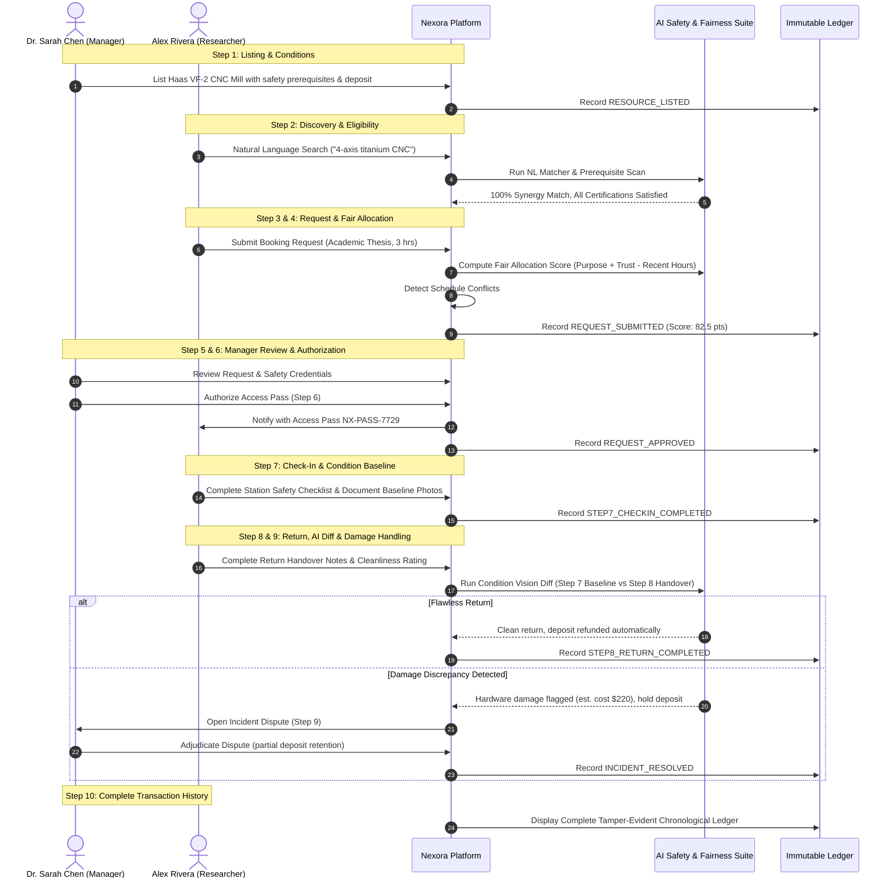

# 🗺️ Nexora User Journeys & Workflow Architecture

This document maps the primary user personas and their end-to-end interactions across the 10-step equipment sharing lifecycle.

---

## 1. Primary Personas

### 🔬 Persona 1: Alex Rivera (PhD Robotics Researcher)
- **Goal:** Access high-precision 4-Axis CNC mill for prototype titanium gripper fingers.
- **Attributes:** Fully certified (Laser Safety Level 2, 5-Axis CNC certified), 94% institutional trust rating.
- **Pain Point:** Equipment at home lab is overbooked; needs transparent cross-institutional access to neighboring facilities.

### 🎓 Persona 2: Dr. Sarah Chen (Shared Facilities Director & Safety Officer)
- **Goal:** Protect $350k institutional equipment from unauthorized operation, tool damage, and scheduling monopolization while ensuring maximum utilization.
- **Attributes:** 14 years in academic safety governance, presiding manager.
- **Pain Point:** Lack of baseline condition verification leaves lab vulnerable to untracked damage disputes.

### 💡 Persona 3: Maya Lin (Undergraduate Engineering Student)
- **Goal:** Access high-speed dynamic camera for senior capstone fluid dynamics study.
- **Attributes:** Clean record, limited credit balance, needs transparent waitlist visibility.
- **Pain Point:** Commercial labs are unaffordable; ordinary booking systems favor tenured faculty over students.

---

## 2. End-to-End Workflow Diagram (10-Step Journey)

